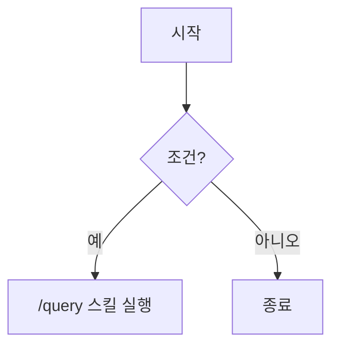

# Mermaid Diagram Rules

Obsidian의 Mermaid 파서는 한글·특수문자·슬래시에 민감하다. 렌더 실패를 예방하려면 아래 규칙을 따른다.

## Rules

1. **모든 노드/엣지 라벨은 큰따옴표로 감쌀 것** — 한글, 공백, 특수문자가 포함된 라벨의 파싱 안정성 확보
2. **`[/` 로 시작하는 라벨 금지** — Mermaid가 trapezoid 도형 시작 기호로 파싱 → lexical error
3. **엣지 라벨(`|...|`)도 따옴표 권장** — 한글/공백이 많으면 파서 실패 가능
4. **라벨 내 마크다운 문법 금지** — `**bold**`, `[[wikilink]]`, backtick 등은 렌더 깨짐
5. **복잡한 플로우는 square layout 선호** — `flowchart TB` + `subgraph LR` 조합

## Pele 규칙 (2026-10-21, 2026-10-23 갱신)

볼트는 Obsidian 1.15+에 든 Pele(1.15.0은 1.8.0)가 그리고, 브리프·덱·보고서·블로그·웹 같은 발행본은 정본 모듈 `/Users/yohankoo/DEV/cmds-pele`의 Pele(버전은 모듈 `vendor/pele/CURRENT` — 2026-10-27부터 npm 최신판을 자동 추종)가 그린다. 33종이 모두 양쪽에서 보인다. 같은 소스가 양쪽에서 같은 색과 강조로 보이게 아래를 지킨다.

6. **색을 하드코딩하지 않는다** — `style`, `classDef ... fill:`, `linkStyle`, `themeVariables` 대신 `%% @key: A`, `%% @interp: B`, `%% @aux: C` 지시문을 쓴다. 발행본은 cmds-pele가, 볼트는 `cmds-pele-vault` 플러그인이 같은 토큰(라이트 초록, 다크 분홍)으로 지시문을 칠한다
7. **캡션은 닫는 펜스 바로 다음 줄의 이탤릭 한 줄** — `*주장 한 문장.*` 그림 번호는 붙이지 않는다
8. **타입별 따옴표** — quadrantChart는 축·사분면·점 라벨의 한글을 따옴표로 감싸고 `title`은 감싸지 않는다(Pele가 따옴표를 그대로 그린다). architecture 라벨은 `["…"]`. sankey 노드 이름은 ASCII만 쓴다(발행본은 Pele 1.9.0부터 한글을 받지만 볼트 1.8.0은 파싱 오류)
9. **블록 첫 줄을 빈 `%%`로 두지 않는다** — Pele가 도식 종류를 찾지 못한다
10. **볼트 버전 기준으로 쓴다** — 볼트의 Pele가 발행본보다 늦을 수 있다. `List<T>` 같은 꺾쇠 글자는 `#lt;T#gt;`로 쓰고(볼트는 `<T>`를 지운다), 라벨의 `<code>`·`<kbd>`·`<sub>` 모양은 발행본에서만 나니 뜻을 모양에 기대지 않는다. 목록 정본은 모듈 `catalog/catalog.json`의 `peleVaultGap`

검사: `node /Users/yohankoo/DEV/cmds-pele/bin/pele-check.mjs --surface report FILE.md` (오류 0). 볼트 노트는 `--surface vault`로 보고, 이때는 볼트 버전 Pele로도 그려 본다(`vault-parse`). 타입 고르기와 지면별 넣는 법은 `cmds-diagram` 스킬이 정본이다.

## Syntax Reference

Mermaid의 노드 도형 단축 기호:

| 기호 | 의미 |
|------|------|
| `[라벨]` | 직사각형 |
| `(라벨)` | 둥근 직사각형 |
| `{라벨}` | 마름모 (decision) |
| `[/라벨\]` | trapezoid (사다리꼴) |
| `[\라벨/]` | trapezoid alt (역사다리꼴) |
| `[/라벨/]` | 평행사변형 (lean right) |
| `[\라벨\]` | 평행사변형 alt (lean left) |

→ 슬래시로 시작하는 텍스트 라벨을 쓰려면 **반드시 따옴표**로 감싸야 도형 기호로 오해되지 않음.

## Examples

### ✅ Good



### ❌ Bad

```mermaid
flowchart TD
	A[시작] --> B{조건?}
	B -->|예| C[/query 스킬 실행]
	B -->|아니오| D[종료]
```

위 예시는 다음 오류 발생:
- `A[시작]`: 한글 단독은 보통 OK이나 일관성 위해 따옴표 권장
- `C[/query 스킬 실행]`: **`[/` 는 trapezoid 기호** → Lexical error
- 엣지 라벨 `|예|`: 짧은 한글은 보통 OK이나 longer label에선 실패

## Anti-Patterns

```markdown
❌ C[/query 스킬]           # trapezoid 기호로 파싱됨
❌ D[**Bold Label**]       # 마크다운 문법 금지
❌ E[[[wikilink]]]         # wikilink는 Mermaid가 해석 못 함
```

```markdown
✅ C["/query 스킬"]
✅ D["Bold Label"]         # 강조가 필요하면 %% @key: D 지시문으로 (규칙 6 — style 금지)
✅ E["wikilink text"]      # 링크는 click 이벤트로 별도 처리
```

## Related

- Obsidian Mermaid 스킬: `obsidian-mermaid`
- 발행 도식 스킬: `cmds-diagram` (정본 카탈로그 `/Users/yohankoo/DEV/cmds-pele/catalog/`)
- Mermaid 공식: https://mermaid.js.org/syntax/flowchart.html
